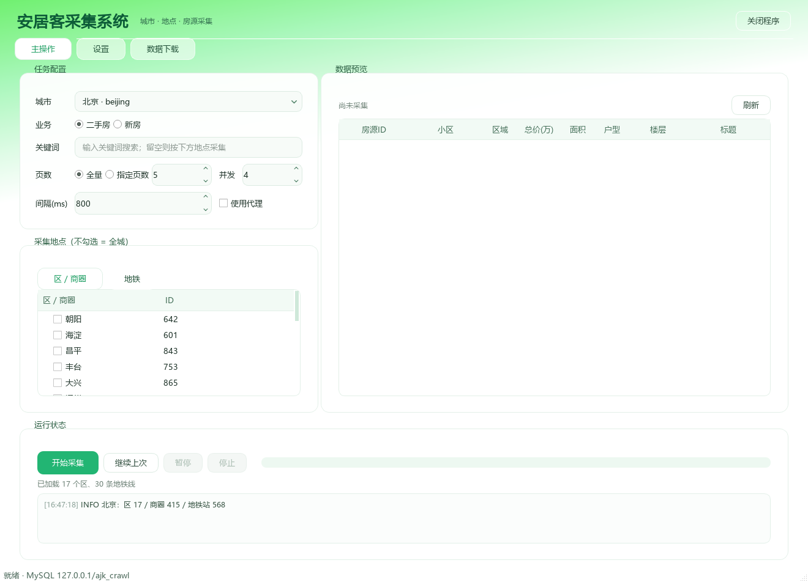
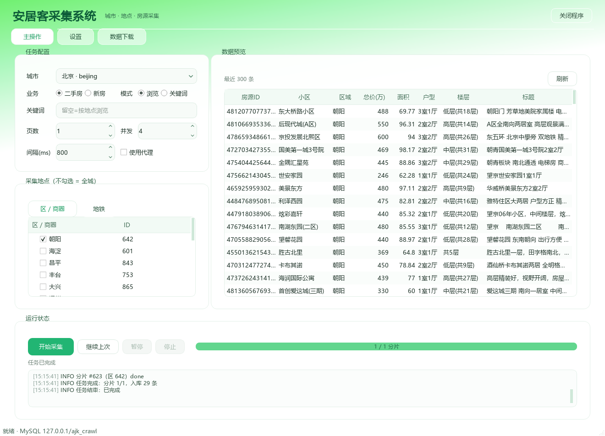

# 安居客房源采集系统

一个面向学习的 **Android 协议分析与数据采集** 项目：还原安居客 App 的请求签名 `nsign`，用 Python 实现「城市 × 区/商圈/地铁/关键词」多维度房源采集，配套 PySide6 桌面端与 MySQL 存储。

> [!WARNING]
> 本项目仅供**个人学习 Android 逆向与后端工程实践**，与安居客、58 同城及其关联公司**无任何关系**，未获其授权。
> 请勿用于商业采集、数据倒卖、批量骚扰、绕过风控或任何违反平台服务条款的用途。
> 使用本项目产生的一切后果由使用者自行承担。



## 功能

- **协议签名**：静态分析 dex / ARM64 汇编，还原 56 位 `nsign`（盐 + path + body 摘要 + 自定义字符序排序 + 自覆盖），Python 复现
- **多维度采集**：城市 / 区 / 商圈 / 地铁线 / 地铁站 / 关键词，支持二手房与新房
- **任务分片**：按探针总量自动下钻（>1500 条拆区、再拆商圈），规避接口约 60 页的分页上限
- **断点续采**：分片游标每页落库，暂停/停止后可从断点继续；进程崩溃重启可恢复
- **幂等入库**：`house_id` / `loupan_id` 唯一键，重复采集只更新不新增
- **桌面端**：任务配置、地点树、实时预览、代理设置、数据下载三页
- **CLI**：`selftest / init-db / areas / crawl / stats`，与 GUI 共用同一套核心代码
- **导出**：按城市/区/商圈统计，流式导出 CSV（UTF-8 BOM，Excel 直接打开）



## 技术栈

Python 3.10+ · PySide6 · MySQL 5.7+ · requests · PyMySQL · PyYAML

## 快速开始

```bash
git clone <your-repo-url>
cd 安居客采集系统

python -m venv .venv
.venv\Scripts\activate          # Windows
pip install -r requirements.txt

# 1. 准备配置
copy config\config.example.yaml config\config.yaml
#    编辑 config.yaml，填 MySQL 账号密码

# 2. 建库建表 + 写入 677 个城市
python cli.py init-db

# 3. 启动 GUI
python run_gui.py
```

首次打开会自动加载默认城市（北京）的区/商圈与地铁，选择地点后点「开始采集」即可。

## 使用

**GUI**：选城市 → 勾选区/商圈/地铁（不勾=全城）或输入关键词 → 选页数（全量/指定）→ 开始采集。右侧实时预览，底部可暂停、停止、继续上次。

**CLI**：

```bash
python cli.py selftest                 # 签名自检（不联网）
python cli.py init-db                  # 建库建表
python cli.py areas --city 13 --save   # 拉取深圳地点
python cli.py crawl --city 13 --area 宝安 --pages 2
python cli.py crawl --city 13 --biz xf --pages 2
python cli.py stats --city 13
```

## 目录结构

```
├── run_gui.py            GUI 入口
├── cli.py                命令行入口
├── core/                 签名、接口、解析、分片、存储
├── gui/                  主操作 / 设置 / 数据下载 三页
├── config/               配置、城市表、设备身份
├── docs/                 执行流程等文档
└── data/                 截图与临时输出
```

## 说明与限制

- 二手房翻页约 60 页后接口返回不可信，因此全量采集必须分片
- 新房 `page_size` 固定 20；新房区域 id 与二手房/城市元数据不通用，暂只支持全城 + 关键词
- 部分城市（三沙、甘南等）城市元数据接口返回错误，界面会显示空地铁并降级为按区/全城采集
- 默认限速 3 QPS，请勿调高到影响目标服务的程度

更多细节：[需求规格](需求-v2.1.md) · [执行流程](docs/执行流程.md)

## 免责声明

1. **用途限制**：本项目及其代码仅用于个人学习 Android 协议分析、逆向工程与后端工程实践，不得用于商业用途、数据售卖、代刷代采、骚扰营销或任何违反法律法规的场景。
2. **非官方项目**：本项目为个人独立作品，与安居客、58 同城及其关联公司没有任何隶属、合作或授权关系；文中出现的名称、商标归其各自权利人所有。
3. **数据范围**：仅解析公开可见的房源列表字段，不采集手机号、400 电话、经纪人或业主联系方式等个人信息；不存储、不传播任何个人敏感数据。
4. **合规使用**：使用者应自行遵守《网络安全法》《个人信息保护法》《数据安全法》等法律法规，以及目标平台的服务条款和 robots 协议；请控制请求频率、避免对目标服务造成影响。
5. **风险自担**：因使用、修改或分发本项目导致的账号封禁、数据丢失、法律纠纷或其他任何直接或间接损失，作者不承担任何责任。
6. **权利主张**：如权利人认为本项目内容侵犯其合法权益，请联系作者，将及时删除相关内容。

> 下载、运行或参考本项目，即视为你已阅读并同意上述声明。如果你不同意，请停止使用。
